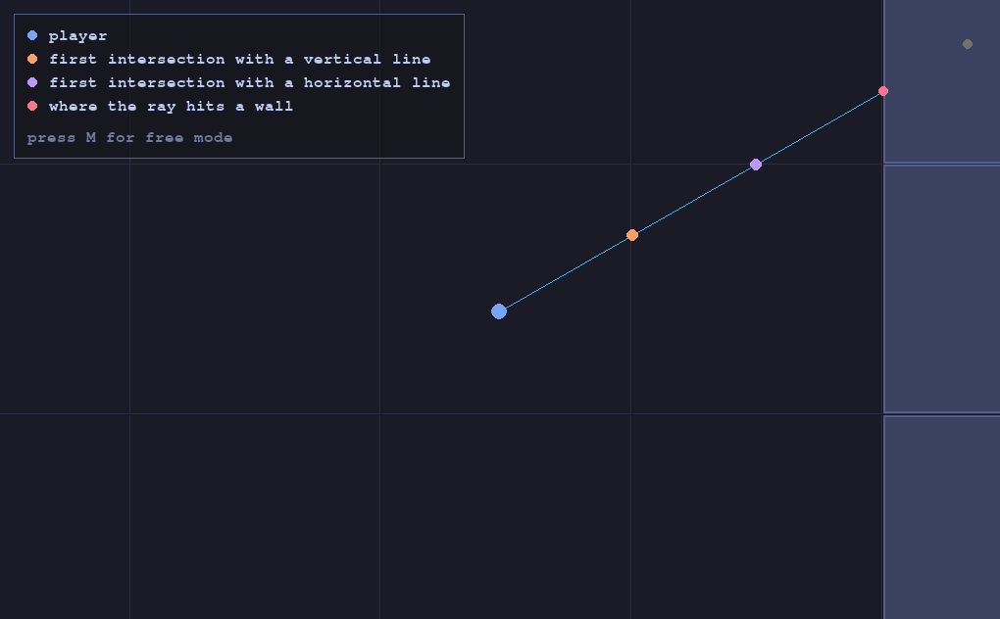

# DDA Visualizer

When trying to understand this algorithm, reading about it wasn't enough, I needed to see it to be able to understand it. Few resources were able to provide that, and that's why I created this.

<div>
    
</div>

If you want to study DDA properly, check out this article:
- [The DDA algorithm explained interactively](https://aaaa.sh/creatures/dda-algorithm-interactive/)

If you're studying raycasting:
- [Lodev raycasting tutorial](https://lodev.org/cgtutor/raycasting.html)

## What DDA is

DDA is an algorithm that finds where a ray hits a wall in a grid, without checking every point along the way. A ray can only enter a new cell by crossing a grid line, so DDA jumps from one intersection point to the next.

It starts from the player's position and calculates two distances: how far the ray has to travel to reach the next vertical line, and how far to reach the next horizontal line. Then it takes whichever is closer, moves into that cell, and checks if it's a wall. If it isn't, it does the same thing again, until it hits one.

## Instructions

### Controls

- `WASD` or arrows to move around
- move your mouse to change the direction of the ray
- `M` to switch between free mode and detailed mode

## Detailed mode

Free mode shows the whole map. Detailed mode zooms in on the player and shows the first two points DDA looks at: where the ray first crosses a vertical line, and where it first crosses a horizontal line. A crossing only shows up if the ray gets there before hitting a wall.

The box in the corner tells you what each color means.

### Running it

You need Python 3 and `make`.

```
make setup
make run
```

That's all.
